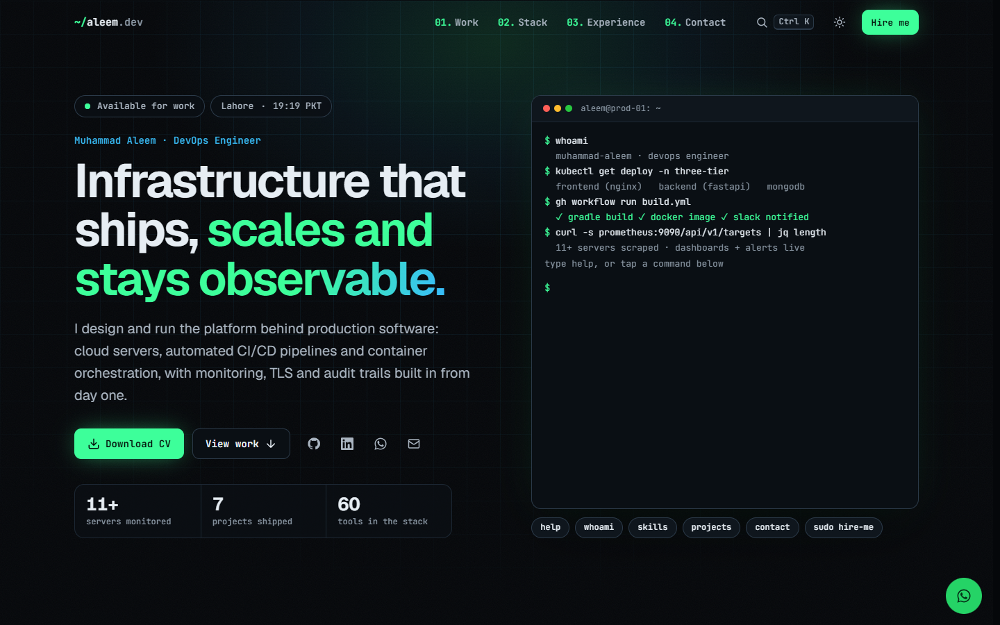

# Muhammad Aleem · DevOps Engineer portfolio

[](https://github.com/aleemtoor222/aleem_devOps/actions/workflows/deploy.yml)

**Live site:** https://aleemtoor222.github.io/aleem_devOps/



A fast, one-page portfolio for a DevOps engineer, built with Next.js 16 (App Router), React 19, TypeScript and
Tailwind CSS 4. It is exported as plain static files and hosted for free on GitHub Pages, with a CI/CD pipeline that
validates the HTML and checks every internal link before each deploy.

## Features

- **Recruiter-first page:** hero with an interactive terminal, a "How I ship" pipeline, filterable project grid with
  case-study dialogs (each one has a shareable link such as `#eks-full-stack-monitoring`), a skills bento, an experience
  timeline and a contact section.
- **Contact that works without a server:** the form posts straight to [Web3Forms](https://web3forms.com) (free), with
  live validation, a spam honeypot, a success animation and, if sending fails, one-click "Email me directly" (pre-filled)
  and "Message on WhatsApp" buttons. Email and phone have copy buttons, and "Save contact" downloads a vCard.
- **Command palette** (Ctrl+K / ⌘K), dark theme plus a light "paper terminal" theme, scroll reveals that respect
  "reduce motion", keyboard and screen-reader friendly, and a clean printable resume layout.
- **SEO:** title and description, canonical URL, Open Graph / Twitter image (`public/assets/og-image.png`),
  JSON-LD `Person` data, `sitemap.xml`, `robots.txt`, favicon and Apple touch icon.
- **Free hosting + CI/CD:** GitHub Actions builds, checks and deploys on every push to `main`; the footer shows the
  deployed commit and date.
- **Tests:** Playwright end-to-end tests using the Microsoft Edge that is already installed (no browser downloads).

## Run it on your computer (Windows PowerShell)

You need Node.js 24 (`node -v` should print `v24…`). Open PowerShell and copy-paste:

```powershell
cd D:\kubeSecOps\portfolio
npm ci
npm run dev -- -p 3401
```

Open http://localhost:3401. Edits to files under `src\` show up immediately. Press `Ctrl+C` to stop.

### Preview exactly what GitHub Pages will serve

```powershell
npm run build:pages
npm run preview:pages
```

Open http://localhost:3402. Missing pages get the real 404 page, as on GitHub Pages. To build for a GitHub Pages
project URL such as `https://aleemtoor222.github.io/aleem_devOps/`, set the sub-path first:

```powershell
$env:PAGES_BASE_PATH = "/aleem_devOps"
npm run build:pages
Remove-Item Env:PAGES_BASE_PATH
npm run preview:pages
```

Then open http://localhost:3402/aleem_devOps/.

> **Why `build:pages` builds in a copy:** a Next.js 16 static export always writes its intermediate files into
> `.next\`, the folder `npm start` serves from. `build:pages` therefore copies the sources to `.pages-build\`, builds
> there, moves the finished site to `out\` and deletes the copy, so a running `next start` server is never disturbed.
> It also refuses to finish if `.next\BUILD_ID` changed. Never run `next build` with `STATIC_EXPORT=1` by hand
> (`next.config.ts` blocks it).
>
> Low on memory? `npm run build:pages -- --skip-typecheck`, then `npx tsc --noEmit` separately (CI always type-checks).

### Quality checks

```powershell
npm run check:html     # HTML validation of out\ (html-validate)
npm run check:links    # broken-link check of out\, internal links only (add -- --verbose to list them)
npm run lint           # ESLint
npx tsc --noEmit       # TypeScript
```

### End-to-end tests (Playwright)

```powershell
npm run build:pages
npm run test:e2e
```

`test:e2e` starts the preview on port 3402 if it is not already running. For a build with a base path:

```powershell
$env:E2E_BASE_URL = "http://localhost:3402/aleem_devOps/"
npm run test:e2e
Remove-Item Env:E2E_BASE_URL
```

The tests use the installed Microsoft Edge (`channel: 'msedge'`), one browser at a time. On a fresh machine, install
without downloading Playwright's own browsers: `$env:PLAYWRIGHT_SKIP_BROWSER_DOWNLOAD = "1"; npm ci`. Test artifacts
(screenshots, traces) go to `D:\kubeSecOps-qa-work\portfolio-v2\agent\test-results` on this machine, else `test-results\`.

### Self-hosted server mode (optional)

`npm run build` then `npm start -- -p 3400` runs the Node server (standalone output, strict security headers such as
CSP). Note that `npm run build` replaces `.next\`, so restart a running `npm start` afterwards.

## Turn on the contact form (Web3Forms, free)

1. Go to https://web3forms.com, enter the email address that should receive the messages, and copy the **Access Key**
   they email you.
2. Open `src\content\profile.ts`, find this line and paste the key between the quotes:
   ```ts
   export const WEB3FORMS_ACCESS_KEY = 'YOUR_ACCESS_KEY_HERE';
   ```
3. Commit and push. The key is designed to be public (it can only send to your own inbox).

Until a real key is set, the form shows "Message not sent" with the email and WhatsApp buttons, so no message is lost.

## Publish on GitHub Pages (one-time setup)

1. On GitHub, create a new **public** repository, for example `portfolio`.
2. Push this folder to it (note: `D:\kubeSecOps` is already a Git repository, so use a separate copy of this folder,
   or remove it from the parent repository first):
   ```powershell
   cd D:\path\to\portfolio-copy
   git init -b main
   git add .
   git commit -m "Portfolio"
   git remote add origin https://github.com/aleemtoor222/aleem_devOps.git
   git push -u origin main
   ```
3. In the repository: **Settings → Pages → Build and deployment → Source: GitHub Actions**.
4. Open the **Actions** tab: the "Deploy to GitHub Pages" run takes 2–3 minutes. The site URL appears in the run
   summary and under Settings → Pages (for this repo it is `https://aleemtoor222.github.io/aleem_devOps/`).

A custom domain works too (Settings → Pages → Custom domain): the workflow picks up the new address automatically.

## How the pipeline works

`.github/workflows/deploy.yml` runs on every push to `main` (and manually via "Run workflow"):

| Job | Steps |
| --- | --- |
| **check** | `npm ci` → `configure-pages` (gives the site URL and base path) → `npm run build:pages` → `npm run check:html` → `npm run check:links` |
| **deploy** (only if check passed) | `npm ci` → `configure-pages` → write `public/build-info.json` (short commit SHA + UTC date) → `npm run build:pages` → upload `out/` → `deploy-pages` |

The build info appears in the footer as "deployed via GitHub Actions · build abc1234 · updated 2026-10-26".
Only one deployment runs at a time (`concurrency: pages`). Permissions are the minimum Pages needs
(`contents: read`, `pages: write`, `id-token: write`).

## Where to edit content

**`src/content/profile.ts` is the single source of truth:** name, email, phone, WhatsApp, GitHub, LinkedIn, CV,
hero text, terminal lines, pipeline, skills, projects (with case studies), experience and certifications. Counts,
filters, the pipeline tools, the terminal and the command palette are computed from it (`src/content/derive.ts`), so
nothing drifts.

| What | Where |
| --- | --- |
| CV PDF | `public/Muhammad_Aleem_DevOps_Engineer_Resume.pdf` (the name must match `profile.cv.file`; GitHub Pages is case-sensitive) |
| Social preview image (1200×630) | `public/assets/og-image.png` |
| Favicon / Apple touch icon | `src/app/icon.svg` / `src/app/apple-icon.png` |
| SEO title, description, Open Graph | `src/lib/seo.ts` (reads `profile.ts`) |
| Colours, spacing, motion (design tokens) | `src/styles/tokens.css` |
| Analytics (optional, GoatCounter) | `site.goatcounterCode` in `profile.ts` |

## HTML validation: rules that are switched off

`.htmlvalidate.json` uses html-validate's recommended rules, minus the ones React / Next.js markup breaks by design:

| Rule | Why |
| --- | --- |
| `void-style` | React writes void elements self-closed (`<meta />`, `<link />`). |
| `attr-case` | React keeps camelCase names such as `charSet`, `fetchPriority`, `noModule` (HTML attribute names are case-insensitive). |
| `attribute-boolean-style`, `attribute-empty-style` | Next.js writes `async=""`, `hidden=""`, `crossorigin=""`. |
| `valid-id` (relaxed) | React's `useId()` generates ids such as `_R_1_`. |
| `prefer-native-element` (listbox excluded) | The command palette uses the ARIA combobox + listbox pattern; a native `<select>` cannot filter as you type. |

## Project layout

```
src/app/            layout, page, 404 (not-found.tsx), robots.ts, sitemap.ts, icons
src/components/     sections (hero, pipeline, work, stack, experience, contact), header, footer, palette, toasts
src/content/        profile.ts (all content) + derive.ts (computed data)
src/lib/            client helpers, SEO metadata, base-path helpers
src/styles/         design tokens and component styles
scripts/            build-pages.mjs, serve-pages.mjs, check-links.mjs
tests/e2e/          Playwright tests
.github/workflows/  deploy.yml
```

## TODO

- [ ] Add the Web3Forms access key (`src/content/profile.ts`).
- [ ] Confirm the contact email: the site uses aleemdevops123@gmail.com, the CV lists muhammadaleemtoor@gmail.com.
- [x] GitHub repository created: https://github.com/aleemtoor222/aleem_devOps
- [ ] Enable Pages once: Settings → Pages → Source: GitHub Actions (then re-run the workflow).
- [ ] Add repository links (`links.code`) and one measurable result (`impact`) for the projects that lack them.
- [ ] Fill in the case-study sections marked TODO (problem, decisions, results, what I'd improve).
- [ ] Confirm the service name in "High-Availability Proxies" (SmsBridge or SmsFort).
- [ ] Add certifications (the section stays hidden while the list is empty).
- [ ] Optional: GoatCounter analytics code (`site.goatcounterCode`).
